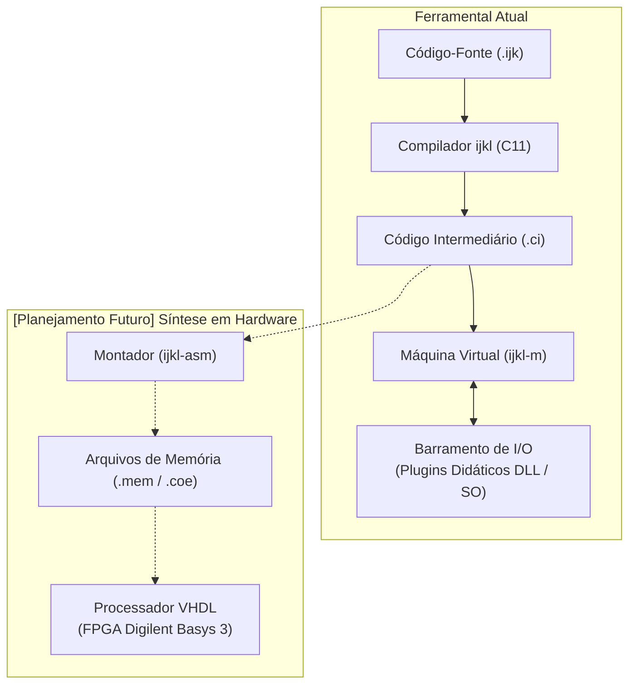

# ijkLang (`ijkL`)

O **ijkLang** (`ijkL`) é um ecossistema educacional de código aberto, implementado em C (norma ISO C11), voltado ao estudo integrado de lógica de programação, linguagens formais, compiladores e organização de computadores.

A denominação **ijkL** estabelece uma analogia pedagógica: da mesma forma que a sequência *a, b, c, d* representa a etapa inicial da alfabetização na linguagem escrita, as variáveis *i, j, k, l* constituem os identificadores canônicos para controle de iterações e indexação na formação inicial em computação. O projeto adota essa referência para estruturar um percurso que parte da elaboração de algoritmos elementares até a compreensão dos mecanismos de execução em hardware.

> **Nota de Lançamento (Versão 0.2.0)**: Esta versão 0.2.0 é produzida a partir da versão 0.1.0 desenvolvida em 2004 pelo mesmo autor, porém revisada e reestruturada com assistência de inteligência artificial para o ensino contemporâneo de lógica de programação, compiladores e organização de computadores.

---

## Início Rápido (Quickstart)

Para compilar as ferramentas e experimentar imediatamente o ciclo completo de desenvolvimento (análise léxica, visualização da árvore sintática, emissão do código intermediário e execução com depurador na máquina virtual), consulte o guia prático passo a passo:

**[Acesse o Guia de Início Rápido: QUICKSTART.md](QUICKSTART.md)**

O guia apresenta instruções práticas para montagem do ambiente tanto no **Windows** (MSBuild / Visual Studio) quanto no **Linux / macOS** (GCC / Make), acompanhado de um programa de exemplo completo com funções, ponteiros, laços e estruturas de decisão para validação prática dos recursos do compilador e da máquina virtual.

---

## 1. Arquitetura do Sistema

O ecossistema organiza o processo de compilação e execução através de etapas bem delimitadas, interligadas por representações formais textuais:



---

## 2. Componentes Principais

### 2.1 Compilador (`ijkl`)
- **Analisador Léxico**: Converte o fluxo contínuo de caracteres do arquivo-fonte em uma sequência de símbolos léxicos (*tokens*). Implementado via Autômato Finito Determinístico (AFD) com tabela de transições e decodificador UTF-8 para suporte nativo a caracteres acentuados.
- **Configuração Multilíngue**: O arquivo de configuração `ijkl.ini` chaveia dicionários de termos da linguagem (`keywords/*.words`), permitindo a escrita de programas em português (`pt-BR`), inglês (`en-US`) ou outros idiomas configurados sem alterações no código-fonte do compilador.
- **Analisador Sintático**: Analisador descendente recursivo preditivo que valida a estrutura gramatical das instruções e constrói uma Árvore Sintática Abstrata (AST) tipada, inspecionável em formato textual via `--ast`.
- **Análise Semântica e Escopos**: Tabela de símbolos hierárquica por escopos com verificação estrita de tipos, checagem de visibilidade de identificadores e cálculo de alinhamento de memória.
- **Emissão de Código Intermediário**: Geração de código linear legível (`*.ci`), baseado em instruções operacionais com registradores e endereçamento formal relativo a quadros de pilha.

### 2.2 Máquina Virtual e Depurador (`ijkl-m`)
- **Modelo de Execução**: Arquitetura baseada em registradores de 64 bits de uso geral (`r0` a `r4`), registrador de instrução (`ci`), apontador de pilha (`sp`) e base de ativação de quadros (`ra`).
- **Tipos de Dados Suportados**: Inteiros de 64 bits, números em ponto flutuante de dupla precisão (IEEE 754), caracteres UTF-8, cadeias de caracteres e booleanos.
- **Gerenciamento de Memória**: Estrutura transparente com pilha de chamada para quadros de ativação (`alloc_frame` e `free_frame`) e área de memória dinâmica (*heap*) com alocação gerenciada.
- **Barramento de Entrada e Saída**: Mapeamento de portas de 16 bits (`0x0000` a `0xFFFF`) para comunicação síncrona com periféricos externos e simulação de hardware.
- **Depuração Integrada (`--debug`)**: Suporte a execução passo a passo (*step into*), definição de pontos de parada (*breakpoints*), inspeção de registradores, visualização de memória e rastreamento de pilha (*backtrace*).
- **Métricas de Execução (`--stats`)**: Registro estatístico de instruções processadas, pico de utilização de memória da pilha e alocações de heap.

### 2.3 Interface de Extensão para Periféricos
- Interface em linguagem C (`include/ijkl_device_api.h`) para criação de módulos de dispositivos externos (como displays de 7 segmentos, semáforos, sensores e atuadores) carregados dinamicamente como bibliotecas compartilhadas (`.dll` no Windows ou `.so` no Linux).

---

## 3. Projetos Complementares em Desenvolvimento

O planejamento do ecossistema prevê a expansão das etapas de compilação em direção à síntese física em circuitos digitais e a ferramentas de terminal:

1. **Montador Educacional (`ijkl-asm`)**:
   - Módulo em C11 responsável pela tradução das instruções do código intermediário (`*.ci`) para representação binária de máquina.
   - Geração de arquivos de inicialização de memória ROM/BRAM nos formatos `.mem` e `.coe`, compatíveis com ferramentas de síntese digital (como Xilinx Vivado).

2. **Processador em VHDL para FPGA Digilent Basys 3**:
   - Descrição em VHDL sintetizável da arquitetura de processamento correspondente à especificação do `ijkl-m`.
   - Execução direta dos programas em hardware reconfigurável na placa **Digilent Basys 3** (FPGA Artix-7), utilizando os elementos de interface disponíveis no circuito (chaves, botões, LEDs e mostradores de sete segmentos).

3. **Ambiente Textual de Desenvolvimento (`ijkl-tui`)**:
   - Interface de desenvolvimento em modo texto construída com sequências de escape ANSI padrão, integrando edição, compilação e controle do depurador no terminal.

---

## 4. Organização do Repositório

```text
ijkLang/
├── bin/                 # Binários compilados resultantes da compilação (Debug / Release)
├── build/               # Artefatos intermediários do processo de compilação
├── docs/                # Documentação técnica e didática aprofundada do ecossistema
├── examples/            # Biblioteca de programas de demonstração da linguagem
│   ├── apps/            # Aplicações completas e modulares (ex.: onm — Object Notation Management)
│   ├── en-US/           # Tutoriais conceituais numerados com palavras-chave em inglês (01 a 15)
│   └── pt-BR/           # Tutoriais conceituais numerados com palavras-chave em português (01 a 15)
├── include/             # Arquivos de cabeçalho da interface pública (norma ISO C11)
│   ├── vm/              # Cabeçalhos da máquina virtual, barramento de I/O e plugins
│   └── ...
├── keywords/            # Tabelas de vocabulário e termos da linguagem (pt-BR.words, en-US.words)
├── lib/                 # Biblioteca padrão do framework implementada em ijkLang
│   └── ijkL/            # Módulos: Text, Math, Memory, Collections, Convert e IO
├── src/                 # Implementação dos módulos do compilador e da máquina virtual
│   ├── common/          # Módulos compartilhados (arena de memória e decodificação UTF-8)
│   ├── compiler/        # Código-fonte do compilador ijkl
│   └── vm/              # Código-fonte da máquina virtual ijkl-m
├── tests/               # Scripts e casos de teste automatizados de validação
├── CONTRIBUTING.md      # Guia de contribuição e padrões de Clean Code em C11
├── LICENSE              # Termos formais de licença (PolyForm Noncommercial 1.0.0)
├── QUICKSTART.md        # Guia prático de primeiros passos e testes do ambiente
├── ijkl.ini             # Arquivo de configuração operacional do compilador
├── ijkL.sln             # Arquivo de solução do Microsoft Visual Studio
└── README.md            # Apresentação geral e arquitetura do projeto
```

---

## 5. Compilação e Testes

### Pré-requisitos
- Compilador C com suporte à norma **ISO C11** (MSVC 2019/2022 v143+ no Windows ou GCC/Clang em sistemas Unix).
- PowerShell 5.1 ou superior (para execução da suíte de automação no Windows).
- GNU Make (opcional, para automação em sistemas Unix).

### Compilação via MSBuild no Windows
```powershell
MSBuild.exe ijkL.sln -p:Configuration=Debug -p:Platform=x64
```

### Execução dos Testes Automatizados
O projeto possui uma rotina de testes organizada em etapas sucessivas, cobrindo os programas de exemplo em ambos os idiomas suportados:

**No Windows (PowerShell):**
```powershell
powershell -ExecutionPolicy Bypass -File .\tests\run_tests.ps1
powershell -ExecutionPolicy Bypass -File .\tests\run_integration_tests.ps1
powershell -ExecutionPolicy Bypass -File .\examples\apps\onm\tests\run_tests.ps1
```

**No Linux ou macOS (Bash / Make):**
```bash
./tests/run_tests.sh
./tests/run_integration_tests.sh
./examples/apps/onm/tests/run_tests.sh
# ou via Makefile:
make test
make test-integration
```

Etapas verificadas:
1. **Léxico (`--tokens`)**: Reconhecimento e classificação correta dos símbolos e literais.
2. **Sintático (`--ast`)**: Construção válida da Árvore Sintática Abstrata tipada.
3. **Semântico (`--symtab`)**: Resolução de escopos, verificação de tipos e alinhamento de dados.
4. **Geração de Código (`--codegen`)**: Emissão do código intermediário textual correspondente.
5. **Máquina Virtual (`ijkl-m`)**: Execução das instruções com conferência do comportamento operacional.

### Publicação e Distribuição
Para distribuir os binários compilados, configuração e dicionários de vocabulário diretamente para outros projetos (como `../ijkDemo`):
- **No Linux ou macOS**: `make publish ../ijkDemo` (ou `make publish DEST=../ijkDemo`)
- **No Windows (PowerShell)**: `.\publish.ps1 ..\ijkDemo`

---

## 6. Licença e Aplicação Didática

O ecossistema **ijkLang (`ijkL`)** destina-se a fins pedagógicos, acadêmicos e de estudo pessoal, servindo como suporte prático a disciplinas de Introdução à Programação, Arquitetura e Organização de Computadores, Linguagens de Programação e Compiladores.

- **Código-Fonte**: Distribuído sob os termos da **PolyForm Noncommercial License 1.0.0**, que permite o uso gratuito, estudo, cópia, modificação e extensão para finalidades educacionais e pessoais, mantendo a atribuição obrigatória da autoria original e vedando expressamente qualquer exploração comercial direta ou indireta.
- **Documentação e Manuais**: Disponibilizados sob a licença **Creative Commons Atribuição-NãoComercial 4.0 Internacional (CC BY-NC 4.0)**.

Para consultar o texto integral dos termos e condições, acesse o arquivo [LICENSE](LICENSE).
