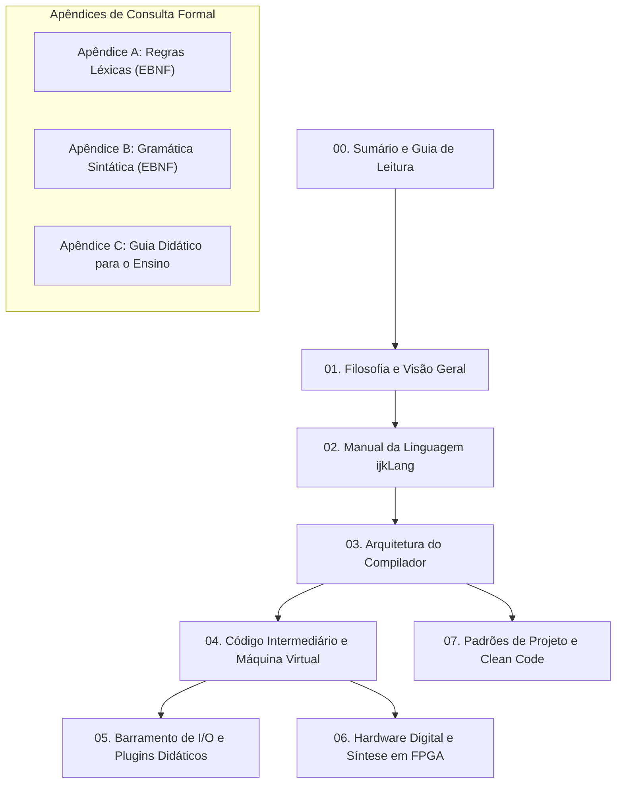

# Sumário Geral e Guia de Leitura

Este documento consolida as especificações formais, diretrizes arquiteturais, manuais operacionais e guias pedagógicos do ecossistema **ijkLang (`ijkL`)**. A documentação foi estruturada para atender desde estudantes do ensino médio técnico e períodos iniciais de graduação até docentes e desenvolvedores de sistemas embarcados e compiladores.

---

## 1. Estrutura dos Capítulos e Apêndices

A documentação divide-se em capítulos temáticos e apêndices de referência formal:

### Relação de Documentos

1. [01. Filosofia e Visão Geral](01_filosofia_e_visao_geral.md): Motivação pedagógica, a analogia conceitual da sequência *i, j, k, l*, a proposta do computador transparente e a visão integrada do código-fonte ao silício.
2. [02. Manual da Linguagem ijkLang](02_manual_da_linguagem_ijklang.md): Guia prático da linguagem com sintaxe em português e inglês, tipos de dados, operadores, estruturas de controle, sub-rotinas e ponteiros.
3. [03. Arquitetura do Compilador](03_arquitetura_do_compilador.md): Funcionamento interno do compilador `ijkl`: analisador léxico por AFD, analisador sintático descendente recursivo, construção da AST e análise semântica por escopos.
4. [04. Código Intermediário e Máquina Virtual](04_codigo_intermediario_e_maquina_virtual.md): Especificação formal da linguagem intermediária (`*.ci`), registradores de 64 bits, pilha de ativação, conjunto de instruções e operação do `ijkl-m` com depurador interativo.
5. [05. Barramento de I/O e Plugins Didáticos](05_barramento_io_e_plugins_didaticos.md): Arquitetura de entrada e saída por portas de 16 bits, interface em C (`ijkl_device_api.h`) e criação de periféricos interativos carregados dinamicamente.
6. [06. Hardware Digital e Síntese em FPGA](06_hardware_digital_e_sintese_fpga.md): Transição para circuitos lógicos: montador educacional (`ijkl-asm`), formatos de memória BRAM (`.mem`/`.coe`) e processador em VHDL para a placa Digilent Basys 3.
7. [07. Padrões de Projeto e Clean Code](07_padroes_de_projeto_e_clean_code.md): Diretrizes de engenharia de software em C11, alocadores de arena de memória, regras de nomenclatura e suíte determinística de testes.
8. [Apêndice A: Regras Léxicas em EBNF](apendice_a_regras_lexicas_ebnf.md): Especificação formal estrita do vocabulário, literais, operadores e tokens da linguagem.
9. [Apêndice B: Gramática Sintática em EBNF](apendice_b_gramatica_sintatica_ebnf.md): Gramática livre de contexto formal e exaustiva para construções de programas, declarações, instruções e expressões.
10. [Apêndice C: Guia Didático para o Ensino](apendice_c_guia_didatico_para_o_ensino.md): Roteiros pedagógicos e planos de aula estruturados para disciplinas de Programação, Arquitetura de Computadores, Linguagens e Compiladores.

---

## 2. Trilhas de Leitura Sugeridas

Para otimizar o estudo conforme os objetivos curriculares ou interesses específicos de cada leitor, recomendam-se as seguintes trilhas:

### Trilha 1: Introdução à Programação e Algoritmos
- **Público**: Estudantes do ensino médio técnico e ingressantes na graduação.
- **Roteiro**: [01. Filosofia e Visão Geral](01_filosofia_e_visao_geral.md) $\rightarrow$ [02. Manual da Linguagem](02_manual_da_linguagem_ijklang.md) $\rightarrow$ [Apêndice C (Seção 1)](apendice_c_guia_didatico_para_o_ensino.md).
- **Foco**: Assimilação de estruturas lógicas (condicionais e laços), modularização por funções e procedimentos, e resolução prática de algoritmos com palavras-chave em português e inglês.

### Trilha 2: Compiladores e Linguagens Formais
- **Público**: Estudantes de ciência da computação e engenharia de software.
- **Roteiro**: [01. Filosofia e Visão Geral](01_filosofia_e_visao_geral.md) $\rightarrow$ [03. Arquitetura do Compilador](03_arquitetura_do_compilador.md) $\rightarrow$ [04. Código Intermediário](04_codigo_intermediario_e_maquina_virtual.md) $\rightarrow$ [Apêndice A](apendice_a_regras_lexicas_ebnf.md) $\rightarrow$ [Apêndice B](apendice_b_gramatica_sintatica_ebnf.md).
- **Foco**: Autômatos finitos determinísticos, análise sintática descendente recursiva, representação em árvore sintática abstrata, tabelas de símbolos por escopos e emissão de código linear.

### Trilha 3: Arquitetura de Computadores e Hardware Digital
- **Público**: Estudantes de engenharia de computação e eletrônica.
- **Roteiro**: [04. Código Intermediário e Máquina Virtual](04_codigo_intermediario_e_maquina_virtual.md) $\rightarrow$ [05. Barramento de I/O](05_barramento_io_e_plugins_didaticos.md) $\rightarrow$ [06. Hardware Digital e FPGA](06_hardware_digital_e_sintese_fpga.md) $\rightarrow$ [Apêndice C (Seção 2)](apendice_c_guia_didatico_para_o_ensino.md).
- **Foco**: Registradores, quadros de ativação na pilha, decodificação de instruções de máquina, barramento de entrada e saída por portas, e síntese de processador em VHDL na placa Digilent Basys 3.

### Trilha 4: Engenharia de Software e Desenvolvimento em C (ISO C11)
- **Público**: Desenvolvedores e estudantes que buscam aprimoramento em programação de sistemas.
- **Roteiro**: [07. Padrões de Projeto e Clean Code](07_padroes_de_projeto_e_clean_code.md) $\rightarrow$ [03. Arquitetura do Compilador](03_arquitetura_do_compilador.md) $\rightarrow$ [04. Código Intermediário e VM](04_codigo_intermediario_e_maquina_virtual.md).
- **Foco**: Alocação de memória baseada em regiões (arenas), portabilidade estrita, ausência de dependências externas e arquitetura de testes automatizados determinísticos.
