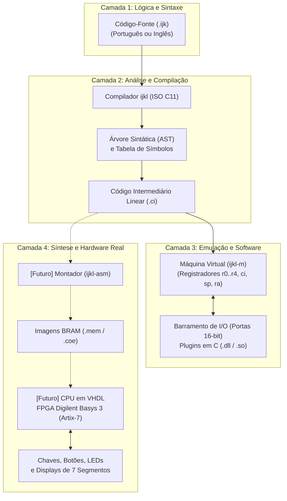

# Filosofia e Visão Geral do Ecossistema ijkLang

O projeto **ijkLang (`ijkL`)** é um ecossistema educacional de código aberto, projetado para o ensino integrado de computação. Sua premissa fundamental consiste em conectar as diferentes camadas de abstração que compõem um sistema de computação, desde a formulação de algoritmos em linguagem de alto nível até a execução física das instruções em circuitos lógicos integrados.

---

## 1. A Motivação Pedagógica: O Modelo do "Computador Transparente"

No ensino tradicional de computação, é frequente a fragmentação entre o aprendizado de linguagens de programação e a compreensão da arquitetura dos computadores. Os estudantes costumam iniciar seus estudos utilizando linguagens interpretadas de alto nível ou ambientes com geradores opacos, nos quais o processo de tradução e execução opera como uma "caixa-preta". Como consequência, conceitos vitais — tais como alocação de memória na pilha, organização de quadros de ativação, representação binária de tipos de dados, latência de barramento e decodificação de instruções em hardware — tornam-se conceitos puramente teóricos e desconectados da prática cotidiana.

O ijkLang propõe o modelo do **computador transparente**. Todas as etapas de transformação pelas quais um algoritmo passa são tornadas visíveis, inspecionáveis e formalmente descritas:

1. O código-fonte de alto nível (`.ijk`) é transformado em uma Árvore Sintática Abstrata (AST) tipada e inspecionável textualmente.
2. A análise semântica projeta os dados em uma tabela de símbolos com cálculo explícito de alinhamento e deslocamentos (*offsets*) de memória.
3. O compilador emite um formato de Código Intermediário (`.ci`) linear, textual e de fácil leitura, com instruções elementares e registradores explícitos.
4. O código intermediário pode ser executado e depurado passo a passo em uma Máquina Virtual de software (`ijkl-m`) ou traduzido por um montador (`ijkl-asm`) para carregamento na memória de um processador em hardware sintetizado em FPGA (placa Digilent Basys 3).

---

## 2. A Analogia Conceitual da Denominação `ijkL`

O nome **ijkL** estabelece uma analogia com a pedagogia do letramento. Na aprendizagem da língua escrita, a sequência alfabética inicial *a, b, c, d* simboliza o domínio dos blocos elementares com os quais se constrói todo o vocabulário posterior.

Na ciência da computação, a sequência de letras *i, j, k, l* cumpre um papel pedagógico análogo:
- Desde as primeiras formulações matemáticas e os pioneiros da programação estruturada, os identificadores *i*, *j*, *k* consolidaram-se universalmente como os índices canônicos para controle de iterações, indexação de vetores e manipulação de matrizes multidimensionais.
- A inclusão da letra *l* (fechando a sigla *ijkL*) remete tanto ao quarto índice de iterações quanto à palavra *Lang* (linguagem) e à *Lógica*, eixo estruturante de todo o projeto.

O ecossistema ijkLang coloca-se, portanto, como uma base introdutória e sólida para a formação em computação, acompanhando o estudante desde a aprendizagem dos conceitos elementares até o entendimento rigoroso da máquina.

---

## 3. A Visão Integrada: Do Algoritmo ao Silício

O ecossistema é composto por quatro módulos centrais perfeitamente articulados:

### 3.1 Compilador `ijkl`
Desenvolvido em C puro conforme o padrão **ISO C11**, sem dependências externas de bibliotecas pesadas ou geradores automáticos de código. Possui analisador léxico construído sobre autômato finito determinístico (AFD), decodificador UTF-8 nativo para suporte a caracteres diacríticos, analisador sintático descendente recursivo com emissão de AST e gerenciador de palavras-chave multilíngues por meio do arquivo de configuração `ijkl.ini`.

### 3.2 Máquina Virtual `ijkl-m`
Implementa um ambiente de execução desacoplado baseado em registradores de 64 bits de uso geral (`r0` a `r4`), registrador de instrução (`ci`), ponteiro de pilha (`sp`) e base de ativação de quadros (`ra`). Fornece suporte nativo a chamadas reentrantes, recursão, tipos dinâmicos com *tags*, gerenciamento seguro de memória de pilha e memória dinâmica (*heap*), além de um depurador interativo em linha de comando (`--debug`) e analisador de ciclos de instrução (`--stats`).

### 3.3 Barramento de Entrada e Saída (I/O) e Plugins de Dispositivos
Oferece um espaço de endereçamento de portas de 16 bits (`0x0000` a `0xFFFF`), desacoplando a lógica computacional do processador da implementação dos dispositivos periféricos. A especificação `include/ijkl_device_api.h` permite que estudantes e professores desenvolvam módulos de periféricos externos em C (como semáforos, painéis de botões, displays de 7 segmentos e sensores industriais), compilando-os como bibliotecas dinâmicas carregadas em tempo de execução.

### 3.4 Rumo ao Hardware: Montador `ijkl-asm` e Processador em VHDL
O código intermediário linear (`*.ci`) foi intencionalmente projetado com instruções simples de registradores e saltos para viabilizar sua tradução direta em código de máquina binário educacional através do utilitário `ijkl-asm`. Este gera arquivos de inicialização de memória ROM/BRAM (`.mem` e `.coe`), os quais alimentam a síntese de uma CPU educacional descrita em VHDL para a placa de prototipagem **Digilent Basys 3** (FPGA Xilinx Artix-7). Dessa forma, o mesmo algoritmo digitado pelo aluno em português ou inglês pode ser executado tanto no terminal de seu computador quanto fisicamente nos circuitos de uma FPGA.
