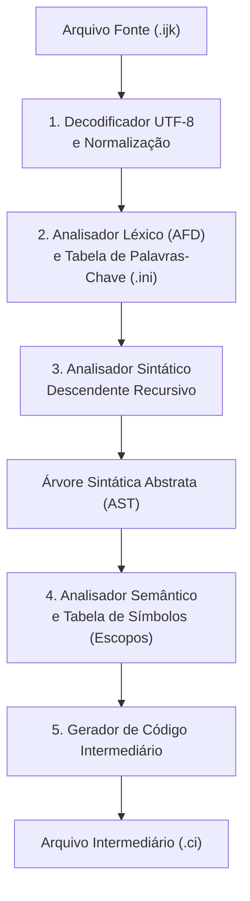
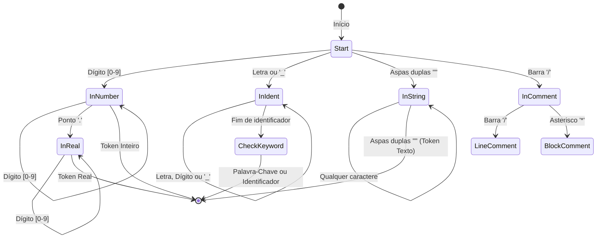
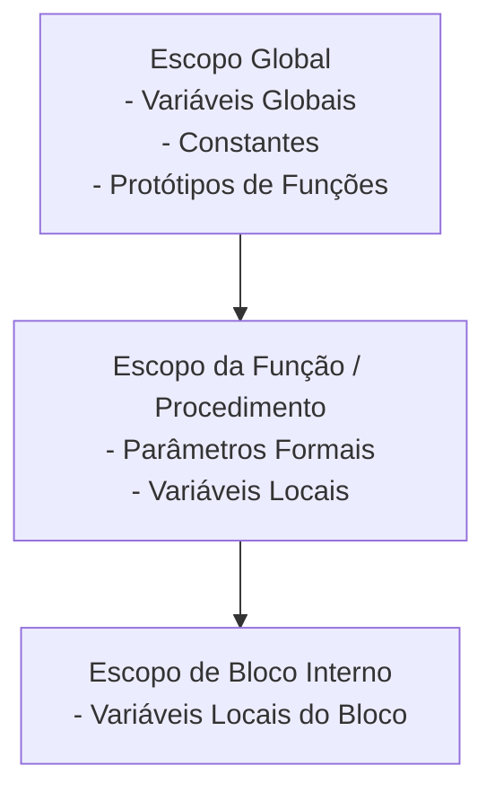
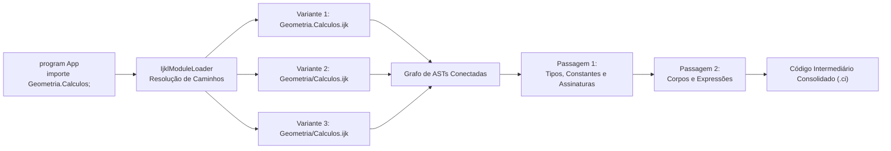
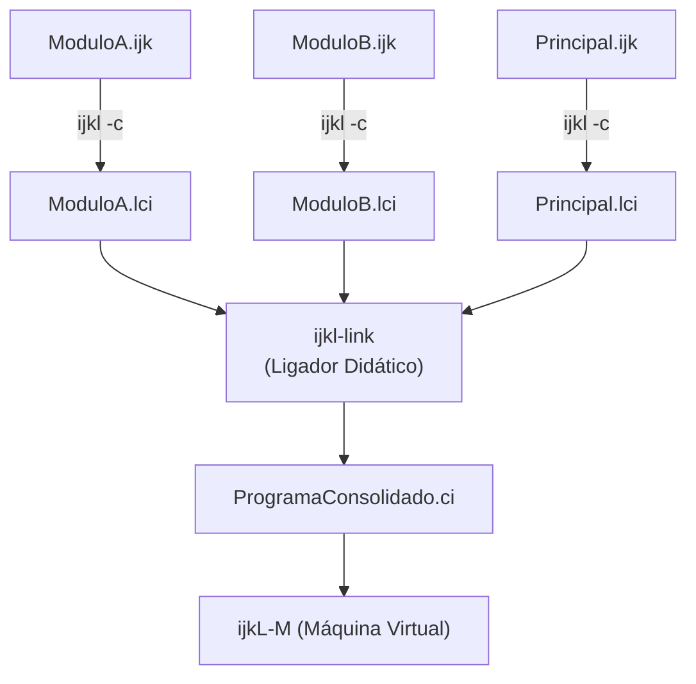

# Arquitetura do Compilador ijkl

O compilador **`ijkl`** foi projetado seguindo a arquitetura clássica de compiladores em estágios sequenciais, implementado estritamente em **C (ISO C11)**. Sua estrutura privilegia a clareza didática, a ausência de dependências externas e o determinismo completo na análise e geração de código.

---

## 1. O Pipeline de Compilação

O processo de tradução organiza-se em um fluxo linear de cinco fases bem delimitadas:



---

## 2. Decodificação UTF-8 e Normalização de Caracteres

A primeira etapa do compilador (`src/common/utf8.c`) processa o fluxo de bytes do arquivo de entrada, convertendo-o em uma sequência uniforme de *codepoints* Unicode de 32 bits (`uint32_t`).

Essa etapa garante:
1. **Transparência Diacrítica**: Suporte pleno a caracteres acentuados da língua portuguesa (como `á`, `é`, `ç`, `õ`) sem comprometer a portabilidade do compilador entre diferentes sistemas operacionais.
2. **Rastreamento de Coordenadas**: Manutenção exata dos números de linha e coluna de cada caractere para fins de diagnóstico de erros.
3. **Robustez de Codificação**: Rejeição imediata de sequências de bytes malformadas antes da fase de análise léxica.

---

## 3. Análise Léxica (Autômato Finito Determinístico)

O analisador léxico (`src/compiler/lexer.c`) é modelado como um **Autômato Finito Determinístico (AFD)** acionado por uma tabela de transições de estados.



### Internacionalização Léxica (`ijkl.ini`)
Ao reconhecer uma cadeia de caracteres alfanuméricos, o lexer consulta a tabela dinâmica de vocabulário (`src/compiler/vocabulary.c`), alimentada na inicialização pela leitura do arquivo `ijkl.ini` e dos dicionários associados:

```ini
; Configuração do compilador ijkl
[compiler]
idioma = pt-BR
palavras_chave = keywords/pt-BR.words
alfabeto_extra = áàâãéêíóôõúüçÁÀÂÃÉÊÍÓÔÕÚÜÇ
```

Se o identificador corresponder a um termo cadastrado no dicionário ativo, o lexer emite o token correspondente à palavra-chave (e.g., `TOKEN_KEYWORD_IF`, `TOKEN_KEYWORD_WHILE`); caso contrário, emite `TOKEN_IDENTIFIER`. Isso possibilita alternar entre português, inglês ou outros idiomas sem recompilar o binário.

---

## 4. Análise Sintática e Árvore Sintática Abstrata (AST)

O analisador sintático (`src/compiler/parser.c`) emprega a técnica **descendente recursiva preditiva** com um símbolo de consulta antecipada (*lookahead* de 1 token).

### Propriedades da Análise Sintática:
- Cada produção gramatical da linguagem é mapeada diretamente para uma função em C (ex.: `ijkl_parser_parse_statement`, `ijkl_parser_parse_expression`).
- As expressões aritméticas e lógicas são analisadas respeitando rigidamente a hierarquia de precedência de operadores.
- Constrói-se em memória uma **Árvore Sintática Abstrata (AST)** tipada (`include/ast.h`), cujos nós representam declarações de variáveis, blocos condicionais, laços de repetição, chamadas de função e operações aritméticas.

### Visualização da AST (`--ast`)
O compilador conta com um formatador hierárquico integrado que imprime a estrutura da árvore sintática no terminal:

```text
CompilationUnit: OlaMundo
└── MainBlock
    └── WriteStatement (Ln: 4, Col: 5)
        └── LiteralString: "Olá, mundo do ijkLang!"
```

---

## 5. Análise Semântica e Tabela de Símbolos por Escopos

A etapa semântica (`src/compiler/symtab.c`) percorre a AST para validar a coerência lógica do programa e organizar os dados em memória.



### Responsabilidades da Análise Semântica:
1. **Resolução de Escopo Estático**: Associação de cada ocorrência de identificador à sua declaração válida mais interna (escopo de bloco $\rightarrow$ escopo de função $\rightarrow$ escopo global).
2. **Checagem Estrita de Tipos**: Verificação de compatibilidade em atribuições, operações binárias e argumentos de chamadas.
3. **Cálculo de Deslocamentos (*Offsets*) e Alinhamento**: Cada variável recebe um deslocamento relativo de memória dentro de seu quadro de ativação, respeitando o alinhamento de bytes dos tipos primitivos e estruturas.
4. **Verificação de Regras de Fluxo**: Validação de que comandos de retorno (`retorne`) possuem o tipo correto da função e que comandos de interrupção (`aborte`) estão contidos em laços válidos.

---

## 6. Geração de Código Intermediário

Na fase final (`src/compiler/codegen.c`), a AST validada e enriquecida pelas informações da tabela de símbolos é traduzida em um fluxo sequencial de instruções no formato de **Código Intermediário (`*.ci`)**.

- Estruturas de controle de fluxo de alto nível (`se`, `enquanto`, `para`) são convertidas em instruções de rótulo e saltos condicionais (`jump_if_zero`, `jump`).
- Expressões complexas são linearizadas utilizando registradores temporários da máquina virtual (`r0` a `r4`).
- Chamadas de procedimentos e funções são instrumentalizadas com o empacotamento de parâmetros e as instruções de demarcação de quadros de ativação (`alloc_frame` e `free_frame`).

---

## 7. Sistema de Módulos e Compilação Multiunidades

A partir da versão modular do ecossistema ijkLang, o compilador suporta a separação de código em unidades lógicas autônomas (`unit` / `unidade`) e unidades executáveis (`program` / `programa`), orquestradas pelo módulo `IjklModuleLoader` (`include/module_loader.h`):



### Características Centrais do Carregador:
1. **Busca Extensiva em Três Variantes**:
   A partir do diretório do programa principal, para um módulo importado `A.B.C`:
   - Variante 1: `A.B.C.ijk` (diretório raiz do projeto).
   - Variante 2: `A.B/C.ijk` (substituição do último ponto por separador).
   - Variante 3: `A/B/C.ijk` (substituição de todos os pontos por separadores).
2. **Resolução Case-Insensitive Multiplataforma**:
   A busca e comparação de caminhos em disco percorre o sistema de arquivos de maneira insensível a maiúsculas e minúsculas no Windows, Linux e macOS, prevenindo discrepâncias entre ambientes operacionais.
3. **Análise em Duas Passagens e Grafos Cíclicos**:
   A construção da tabela de símbolos e análise semântica operam em duas fases:
   - **Passagem 1**: Registra declarações de tipos, constantes, variáveis globais e assinaturas de rotinas de todas as unidades.
   - **Passagem 2**: Analisa os corpos das rotinas e resolve chamadas e expressões.
   Esse mecanismo permite importações circulares e recursão mútua entre módulos sem laços infinitos ou erros de referência prematura.
4. **Sequência de Bootstrap e Ponto de Entrada Normalizado**:
   A execução inicia por uma sequência de bootstrap gerada pelo compilador no rótulo de entrada `<NomeDoPrograma>.main`:
   - Aloca e inicializa as variáveis estáticas dos módulos e do programa no segmento de dados global com suas respectivas expressões constantes.
   - Dispara os procedimentos de ciclo de vida `inicializar` (`initialize`) dos módulos importados na primeira referência (idempotente).
   - Dispara o procedimento `inicializar` do programa principal (caso declarado).
   - Invoca a função principal (`principal` ou `main`, configurada em `KW_MAIN`), estritamente privada, recebendo os argumentos da pilha e retornando o código de término via registrador `r0`.
   - Ao término bem-sucedido de `principal`, executa o `finalizar` (`finalize`) do programa principal e, em seguida, os finalizadores dos módulos importados na ordem inversa. Em caso de erro de execução, a máquina virtual aborta imediatamente sem acionar os finalizadores subsequentes (semântica fail-fast).

---

## 8. Especificação Conceitual: Formato de Objeto Modular (.lci) e Ligador (ijkl-link)

Para viabilizar a **compilação separada e incremental** em projetos de grande escala, o ecossistema projeta a evolução para uma ferramenta ligadora dedicada (**`ijkl-link`**) e um formato de biblioteca objeto modular intermediária (**`.lci`** - *Linear Compiled Intermediate Object*).



### 8.1. Estrutura do Formato de Arquivo `.lci`

O arquivo `.lci` é uma unidade compilada individualmente contendo código intermediário linear e metadados de ligação, estruturado conceitualmente nas seguintes seções:

```text
[LCI_HEADER]
magic = IJKL_LCI_V1
unit_name = GeometriaApp.Calculos
unit_kind = module ; ou program
target_arch = ijkl_vm_64
checksum = <sha256_hash>

[EXPORTS]
; SimboloExportado, Tipo, RotuloInterno, Deslocamento
funcao areaRetangulo(base: real, altura: real): real = #GeometriaApp.Calculos.areaRetangulo
constante PI: real = 3.1415926535

[IMPORTS]
; SimboloExterno, ModuloOrigem
rotina logInfo = Sistema.Log.logInfo

[RELOCATIONS]
; LinhaRelativa, TipoRelocacao, SimboloAlvo
Line 12: RELOC_CALL #Sistema.Log.logInfo
Line 28: RELOC_DATA #Constante_Global

[CODE_SECTION]
#GeometriaApp.Calculos.areaRetangulo:
    alloc_frame 16;
    r0 := [ra, 0];
    r1 := [ra, 8];
    r0 := r0 * r1;
    free_frame;
    return r0;
```

### 8.2. Papel e Funcionamento do Ligador (`ijkl-link`)

A ferramenta `ijkl-link` operará de forma desacoplada do compilador `ijkl`:

1. **Entrada e Validação**:
   Recebe como entrada um ou mais arquivos `.lci` e bibliotecas estáticas compactadas (`.alci`). Valida a integridade dos cabeçalhos, compatibilidade de versões e ausência de símbolos públicos duplicados (colisões de exportação).
2. **Resolução de Símbolos Pendentes**:
   Percorre a tabela de `[IMPORTS]` de cada arquivo `.lci` e localiza a respectiva definição na tabela `[EXPORTS]` das outras unidades vinculadas.
3. **Relocação de Endereços e Rótulos**:
   Aplica os ajustes indicados na tabela de `[RELOCATIONS]`, unificando a numeração linear de instruções e garantindo que rótulos simbólicos externos apontem para suas instruções de destino reais.
4. **Otimização por Eliminação de Código Morto (*Tree Shaking*)**:
   A partir do ponto de entrada `<Programa>.main`, o ligador constrói o grafo de chamadas alcançáveis (*call graph reachability*). Rotinas e módulos não referenciados direta ou indiretamente são descartados da saída final, reduzindo a pegada de memória do `.ci`.
5. **Emissão do Executável Linear Consolidado (`.ci`)**:
   Produz o arquivo executável final com salto inicial para `<Programa>.main`, pronto para consumo pela máquina virtual `ijkl-m` ou síntese em hardware FPGA.

