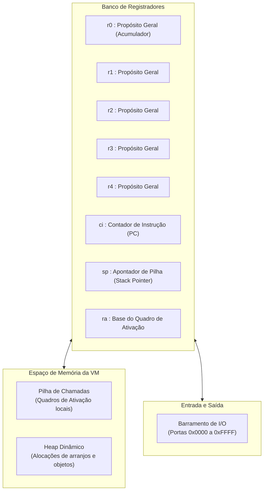
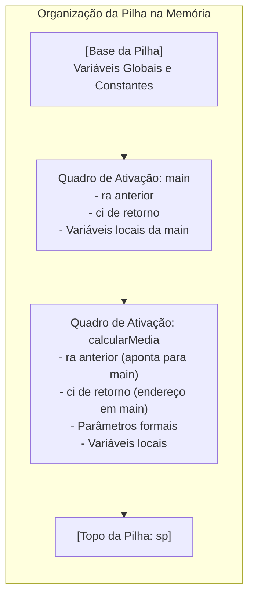

# Código Intermediário e Máquina Virtual

O **Código Intermediário (`*.ci`)** e a **Máquina Virtual (`ijkl-m`)** constituem a ponte fundamental entre a representação abstrata dos programas e a sua execução prática, permitindo que os estudantes compreendam o funcionamento dos processadores reais de maneira controlada e transparente.

---

## 1. O Papel do Código Intermediário (`.ci`)

O formato `.ci` é uma representação intermediária linear em formato texto legível. Diferente de formatos binários opacos (*bytecode* tradicional), o arquivo `.ci` pode ser aberto em qualquer editor de texto e inspecionado visualmente, facilitando o diagnóstico das transformações efetuadas pelo compilador.

### Características do Formato `.ci`:
- Instruções orientadas a três endereços e operações com registradores explícitos.
- Estrutura textual baseada em linhas, com comentários iniciados por ponto e vírgula ou barras.
- Facilidade de tradução direta tanto para emulação em software (`ijkl-m`) quanto para código de máquina de hardware (`ijkl-asm`).

---

## 2. Arquitetura da Máquina Virtual (`ijkl-m`)

O ambiente de execução da máquina virtual é baseado em um modelo de máquina de registradores de 64 bits com pilha de execução:

### Registradores do Sistema
- **`r0` a `r4`**: Registradores de uso geral de 64 bits para avaliação de expressões aritméticas, lógicas e passagem de parâmetros imediatos.
- **`ci` (*Current Instruction*)**: Registrador que armazena o índice da instrução corrente em execução.
- **`sp` (*Stack Pointer*)**: Apontador para o topo da pilha de execução.
- **`ra` (*Activation Record Base*)**: Registrador que referencia a base do quadro de ativação corrente para acesso a variáveis locais e parâmetros formais.

---

## 3. Sistema de Tipos da Máquina Virtual

Cada célula de registrador e elemento da pilha armazena uma estrutura tipada (*tagged value*) com as seguintes variedades:
- `VAL_INT`: Inteiro de 64 bits com sinal (`int64_t`).
- `VAL_FLOAT`: Ponto flutuante IEEE 754 de dupla precisão (`double`).
- `VAL_CHAR`: Ponto Unicode de caractere de 32 bits (`uint32_t`).
- `VAL_BOOL`: Booleano lógico (`0` para falso, `1` para verdadeiro).
- `VAL_STRING`: Ponteiro para cadeia de texto terminada em nulo alocada na memória.

---

## 4. Gerenciamento de Memória: Pilha e Quadros de Ativação

A execução de sub-rotinas (procedimentos e funções) apoia-se em uma pilha de execução contínua, estruturada por quadros de ativação gerenciados em tempo $O(1)$:

### Instruções de Quadro de Ativação:
- **`alloc_frame [tamanho];`**: Salva o valor atual de `ra` na pilha, atualiza `ra` para a base do novo quadro e desloca o apontador `sp` para reservar espaço para as variáveis locais.
- **`free_frame;`**: Desaloca as variáveis locais da sub-rotina, restaura o valor original de `ra` e reposiciona `sp` no quadro anterior.

---

## 5. Conjunto de Instruções Operacionais

As instruções do código intermediário agrupam-se em categorias funcionais:

### 5.1 Movimentação e Carga de Dados
- `mov dest, src;`: Copia o valor de um registrador ou constante para outro registrador.
- `load dest, [base + offset];`: Carrega valor da memória da pilha ou heap para um registrador.
- `store [base + offset], src;`: Escreve o conteúdo de um registrador na posição indicada de memória.

### 5.2 Operações Aritméticas e Lógicas
- Aritméticas: `add`, `sub`, `mul`, `div`, `mod`.
- Lógicas: `and`, `or`, `not`.
- Relacionais: `eq`, `neq`, `lt`, `lte`, `gt`, `gte`.

### 5.3 Controle de Fluxo e Sub-rotinas
- `jump rotulo;`: Salto incondicional para o rótulo especificado.
- `jump_if_zero reg, rotulo;`: Salto condicional se o conteúdo do registrador for zero (falso).
- `jump_if_not_zero reg, rotulo;`: Salto condicional se o conteúdo do registrador for diferente de zero (verdadeiro).
- `call subrotina;`: Empilha o endereço da próxima instrução e desvia a execução para a sub-rotina.
- `ret;`: Desempilha o endereço de retorno e restaura a execução do chamador.
- `halt;`: Encerra a execução do programa.

### 5.4 Entrada e Saída (I/O)
- `in reg, porta;`: Lê o valor de 16 bits presente na porta do barramento e armazena no registrador.
- `out porta, reg;`: Escreve o valor do registrador na porta correspondente do barramento.

---

## 6. Depurador Interativo CLI (`--debug`)

A máquina virtual inclui um depurador em modo texto que permite a estudantes e pesquisadores acompanhar a execução de cada instrução em tempo real.

### Comandos do Depurador:
- `step` (ou `s`): Executa uma única instrução e avança o contador `ci` (*step into*).
- `next` (ou `n`): Executa a próxima instrução, avançando chamadas de função de forma atômica (*step over*).
- `break <linha_ou_rotulo>` (ou `b`): Define um ponto de parada (*breakpoint*).
- `regs` (ou `r`): Exibe o conteúdo atual de todos os registradores (`r0` a `r4`, `ci`, `sp`, `ra`).
- `stack [n]` (ou `k`): Exibe as últimas $n$ posições da pilha com os respectivos tipos.
- `mem <endereco> [n]`: Inspeciona $n$ células da memória a partir do endereço fornecido.
- `continue` (ou `c`): Prossegue a execução contínua até o próximo ponto de parada ou final do programa.
- `quit` (ou `q`): Interrompe a sessão da máquina virtual.

---

## 7. Métricas de Execução (`--stats`)

Quando executada com a opção `--stats`, a máquina virtual gera um relatório analítico ao término do programa:
- Total de instruções processadas e ciclos computados.
- Pico de memória ocupado pela pilha de execução.
- Quantidade total de alocações e liberações no heap.
- Histórico de acessos ao barramento de I/O.
