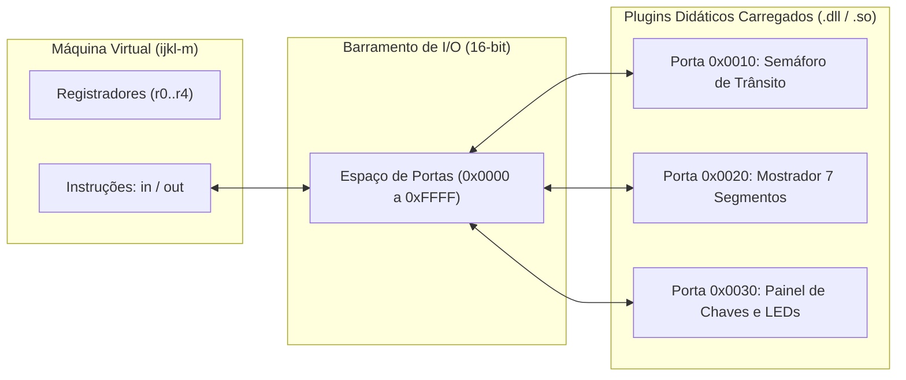

# Barramento de Entrada e Saída e Plugins Didáticos

O estudo da interação entre a Unidade Central de Processamento (CPU) e o ambiente externo constitui um dos temas centrais da disciplina de Arquitetura de Computadores. O ecossistema **ijkLang** introduz esse conceito de forma limpa e modular por meio de um **Barramento de I/O baseado em portas** e uma **API de Plugins Dinâmicos em C**.

---

## 1. Fundamentos de Entrada e Saída: I/O Mapeado em Portas

Na arquitetura de computadores, existem duas abordagens clássicas para comunicação com dispositivos periféricos:
1. **I/O Mapeado em Memória (*Memory-Mapped I/O*)**: As portas dos dispositivos compartilham o mesmo espaço de endereçamento da memória principal RAM.
2. **I/O Mapeado em Portas (*Port-Mapped I/O*)**: A CPU possui um espaço de endereçamento separado exclusivo para entrada e saída, acessado por instruções especializadas (`in` e `out`).

O ijkLang adota o modelo **Port-Mapped I/O**, implementando um barramento com espaço de endereçamento de **16 bits** (`0x0000` a `0xFFFF`), totalizando 65.536 portas lógicas acessíveis:



---

## 2. Instruções de Barramento no Código Intermediário

A comunicação entre a máquina virtual e os periféricos realiza-se por meio de duas instruções atômicas:

### 2.1 Instrução de Saída (`out`)
Escreve o valor armazenado em um registrador de 64 bits em uma porta de 16 bits do barramento:
```text
out 0x0010, r0;   ; Envia o conteúdo de r0 para o dispositivo na porta 0x0010
```

### 2.2 Instrução de Entrada (`in`)
Lê o estado lógico atual da porta indicada e armazena o valor recebido no registrador de destino:
```text
in r1, 0x0030;    ; Lê o valor dos sensores na porta 0x0030 para o registrador r1
```

---

## 3. Especificação da API de Plugins em C (`ijkl_device_api.h`)

Para viabilizar a criação de periféricos personalizados por estudantes e pesquisadores, o sistema disponibiliza uma interface formal em C padrão (`include/ijkl_device_api.h`):

```c
typedef struct IjklDeviceInterface {
    const char* (*get_device_name)(void);
    uint16_t    (*get_base_port)(void);
    uint16_t    (*get_port_count)(void);
    bool        (*initialize)(void);
    int64_t     (*read_port)(uint16_t port_address);
    void        (*write_port)(uint16_t port_address, int64_t value);
    void        (*step_cycle)(void);
    void        (*shutdown)(void);
} IjklDeviceInterface;
```

### Ciclo de Vida do Plugin:
1. **Carregamento Dinâmico**: A máquina virtual carrega a biblioteca compartilhada (`.dll` no Windows ou `.so` no Linux) e localiza o símbolo de exportação `ijkl_plugin_register`.
2. **Inicialização**: Executa `initialize()`, alocando recursos de hardware simulado e registrando o intervalo de portas atribuído ao dispositivo.
3. **Ciclo Operacional**: A cada instrução `in` ou `out` direcionada ao intervalo do periférico, os métodos `read_port()` ou `write_port()` são acionados de maneira síncrona.
4. **Sincronismo de Clock (`step_cycle`)**: Permite a simulação de temporizadores, atrasos físicos de transição e decaimento de sinais.
5. **Encerramento (`shutdown`)**: Libera janelas gráficas, arquivos de log ou conexões associadas ao término da execução da máquina virtual.

---

## 4. Exemplos de Dispositivos Didáticos

### 4.1 Semáforo de Trânsito Educacional (Porta `0x0010`)
Controla o acionamento de lâmpadas de tráfego a partir de uma máscara de bits:
- Bit 0: LED Vermelho (ligado/desligado).
- Bit 1: LED Amarelo (ligado/desligado).
- Bit 2: LED Verde (ligado/desligado).

Um programa em ijkLang pode alternar as fases de um cruzamento através de escritas sequenciais com atrasos calculados:
```text
programa ControleSemaforo {
    privado principal(): inteiro {
        escreva_porta(0x0010, 4); // Bit 2 ativo: Luz Verde
        // Aguarda temporização...
        escreva_porta(0x0010, 2); // Bit 1 ativo: Luz Amarela
        // Aguarda temporização...
        escreva_porta(0x0010, 1); // Bit 0 ativo: Luz Vermelha
        retorne 0;
    }
}
```

### 4.2 Mostrador de 7 Segmentos Multiplexado (Porta `0x0020`)
Recebe dígitos decimais codificados (ou padrões de catodo) e renderiza na interface textual ou gráfica a representação dos mostradores numéricos.

### 4.3 Sensores e Chaves de Entrada (Porta `0x0030`)
Permite ao estudante ler o estado de chaves liga/desliga simuladas pelo usuário no teclado, condicionando laços de controle industrial e atuadores virtuais.
