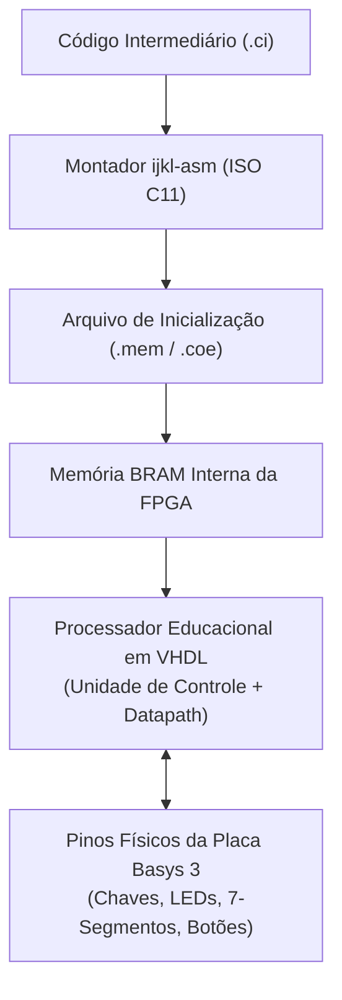
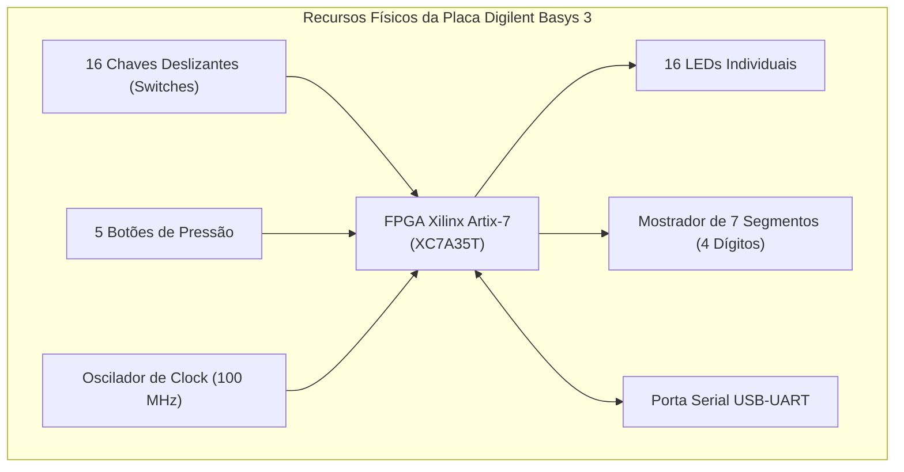
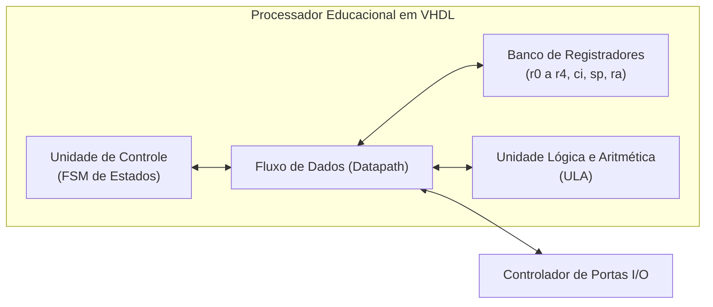

# Hardware Digital e Síntese em FPGA

A transição da representação de software para a execução física em circuitos eletrônicos representa o fechamento do ciclo de aprendizado proposto pelo ecossistema **ijkLang**. Esta etapa materializa os conceitos de arquitetura através do montador educacional **`ijkl-asm`** e da descrição em **VHDL sintetizável** de um processador educacional para a placa **Digilent Basys 3** (baseada na FPGA Xilinx Artix-7).

---

## 1. Do Código Intermediário ao Código de Máquina Binário

Enquanto a máquina virtual (`ijkl-m`) interpreta as instruções do arquivo `.ci` em software, a síntese em hardware requer a conversão dessas instruções em vetores binários fixos (*opcodes* e operandos):

### O Papel do Montador `ijkl-asm`
O utilitário `ijkl-asm` (desenvolvido em C11) realiza as seguintes operações:
1. **Resolução de Rótulos em Endereços**: Converte rótulos simbólicos de saltos e chamadas em endereços absolutos de memória de programa.
2. **Codificação Binária**: Converte nomes de instruções (`mov`, `add`, `jump`) em campos de bits de *opcode*.
3. **Geração de Imagens de Memória**:
   - Formato **`.mem`**: Texto em formato hexadecimal puro aceito por simuladores e ferramentas de inicialização de memória.
   - Formato **`.coe`** (*Coefficient File*): Formato padrão da ferramenta **Xilinx Vivado** para inicialização de blocos de memória interna (*Block RAM* - BRAM).

---

## 2. A Placa Didática Digilent Basys 3 (FPGA Artix-7)

A placa **Digilent Basys 3** é amplamente utilizada em cursos de engenharia de computação e circuitos digitais devido à sua variedade de componentes de interface física diretamente integrados à FPGA Xilinx Artix-7 (modelo XC7A35T-1CPG236C).

### Recursos Integrados Utilizados:
- **16 Chaves Deslizantes (SW0 a SW15)**: Mapeadas como portas lógicas de entrada para fornecimento de dados binários pelo usuário.
- **5 Botões de Pressão (C, U, L, R, D)**: Utilizados como sinais de reset manual, avanço de clock passo a passo e interrupções externas.
- **16 LEDs Indicadores (LD0 a LD15)**: Mapeados para monitoramento do estado das portas de saída e registradores.
- **4 Displays de 7 Segmentos Multiplexados**: Exibição numérica e hexadecimal de dados processados.
- **Memória BRAM Interna**: Utilizada para armazenar tanto as instruções do programa quanto a área de dados da pilha.

---

## 3. Arquitetura da CPU Educacional em VHDL

A CPU implementada em VHDL para a FPGA adota o modelo clássico de máquina de von Neumann simplificada (*Very Simple Computer*), espelhando o comportamento funcional da máquina virtual `ijkl-m`.

### 3.1 Ciclo de Instrução em Hardware
O processador opera através de uma Máquina de Estados Finitos (FSM) síncrona que gerencia o ciclo canônico de execução:
1. **Busca (*Fetch*)**: O endereço presente no registrador `ci` é colocado no barramento de endereços da BRAM, recuperando a palavra de instrução.
2. **Decodificação (*Decode*)**: O decodificador separa o *opcode*, os registradores de origem/destino e constantes imediatas.
3. **Execução (*Execute*)**: A ULA realiza a operação aritmética ou lógica solicitada; se for salto condicional, testa a condição e atualiza `ci`.
4. **Acesso à Memória (*Memory*)**: Leitura ou escrita de dados na pilha ou variáveis globais.
5. **Escrita de Volta (*Write-Back*)**: Armazenamento do resultado final no registrador de destino e incremento de `ci`.

### 3.2 Mapeamento de Portas Físicas (Arquivo de Restrições `.xdc`)
No ambiente Xilinx Vivado, as instruções de barramento `in` e `out` são conectadas aos pinos físicos da FPGA por meio de um arquivo de restrições (`basys3_master.xdc`):
- Leitura na porta `0x0001`: Conectada diretamente aos 16 switches (`SW[15:0]`).
- Escrita na porta `0x0002`: Conectada aos 16 LEDs (`LED[15:0]`).
- Escrita na porta `0x0003`: Conectada ao controlador multiplexador dos 4 displays de 7 segmentos (`SEG[6:0]` e `AN[3:0]`).

Dessa forma, o estudante presencia a correspondência exata entre uma linha de instrução de seu código (ex.: `out 0x0002, r0;`) e o acendimento físico dos LEDs correspondentes na placa de circuito.
