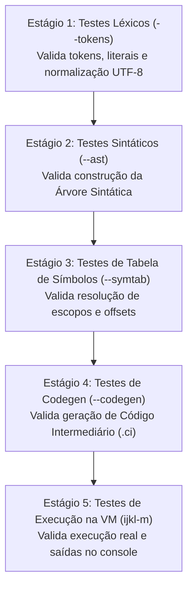

# Padrões de Projeto e Clean Code em C (ISO C11)

A construção de um ecossistema educacional de computação exige rigor na qualidade de código, clareza arquitetural e estabilidade operacional. O código-fonte do **ijkLang** foi projetado para servir como modelo didático de boas práticas de engenharia de software em **C (ISO C11)**.

---

## 1. Princípios de Clean Code Adotados

### 1.1 Identificadores Descritivos em Inglês
Todo o código-fonte (estruturas, funções, parâmetros, campos e variáveis locais) utiliza a língua inglesa (`en-US`) com palavras completas, proibindo o uso de abreviações crípticas ou mnemônicos ambíguos:

| Evitado | Adotado no ijkLang | Razão Arquitetural |
| :--- | :--- | :--- |
| `tok` | `token` | Clareza léxica imediata |
| `stmt` | `statement` | Distinção entre declarações e comandos |
| `expr` | `expression` | Autoexplicativo na análise sintática |
| `len` | `buffer_length` | Especifica se refere ao tamanho de buffer |
| `ret` | `return_value` | Evita confusão com a instrução `ret` |
| `tmp` | `temporary_value` | Explicita a natureza transitória da variável |

### 1.2 Padrão Semântico de Namespace (`ijkl_modulo_acao`)
Para prevenir colisões de símbolos no espaço global de ligação em C e manter uma organização modular evidente, todas as funções e tipos públicos adotam prefixos estruturados:
- Funções públicas: `ijkl_<modulo>_<acao>` (ex.: `ijkl_memory_arena_allocate`, `ijkl_lexer_next_token`, `ijkl_parser_parse_compilation_unit`, `ijkl_vm_execute`).
- Estruturas de dados: `Ijkl<NomeEntidade>` (ex.: `IjklMemoryArena`, `IjklLexer`, `IjklParser`, `IjklAstNode`, `IjklSymbolTable`).

### 1.3 Política Rigorosa de Comentários em Português
- **Comentários Conceituais (`pt-BR`)**: O propósito pedagógico e o funcionamento dos módulos são documentados em português culto.
- **Foco em Efeitos Colaterais e Decisões Não Óbvias**: Comentam-se mutações de estado, regras de precedência especiais e estratégias de lookahead.
- **Ausência de Comentários Redundantes**: Não se inserem comentários em operações autoevidentes (como incrementos de contadores ou consumo trivial de pontuação).

---

## 2. Gerenciamento de Memória Baseado em Regiões (Arenas)

Um dos maiores desafios no desenvolvimento de compiladores em C reside no gerenciamento de memória. A fragmentação e os riscos de vazamento (*memory leaks*) decorrentes de múltiplas chamadas individuais a `malloc` e `free` para milhares de nós de árvores sintáticas e identificadores podem comprometer a estabilidade do sistema.

O ijkLang adota o padrão de **Gerenciamento de Memória por Arenas** (`src/common/memory.c`):

```mermaid
flowchart LR
    subgraph Arena ["IjklMemoryArena (Bloco Contínuo de Memória)"]
        direction TB
        B1["Nó AST: DeclaracaoVariavel"]
        B2["Nó AST: OperacaoBinaria (Soma)"]
        B3["Cadeia de Caracteres: 'OlaMundo'"]
        B4["Símbolo: 'idade' (Offset: 0)"]
        FREE["Memória Livre Restante da Arena"]
        B1 --- B2 --- B3 --- B4 --- FREE
    end

    ALLOC["ijkl_memory_arena_allocate(size)"] -->|Alocação em O(1)| FREE
    DESTROY["ijkl_memory_arena_destroy()"] -->|Liberação Única em O(1)| Arena
```

### Vantagens do Alocador de Arena:
1. **Alocação Rápida em Tempo $O(1)$**: Consiste unicamente no avanço de um ponteiro de deslocamento dentro do bloco pré-alocado.
2. **Localidade Espacial de Cache**: Nós criados em sequência temporal ficam contíguos na memória física, otimizando os acessos da CPU.
3. **Liberação Instantânea e Garantia de Ausência de Vazamentos**: Ao término da compilação, uma única chamada (`ijkl_memory_arena_destroy`) devolve toda a memória do compilador ao sistema operacional de forma atômica.

---

## 3. Arquitetura de Testes Automatizados por Estágios

A validação de compiladores e máquinas virtuais requer um processo determinístico que isole erros em cada camada de tradução. Os scripts de automação (`tests/run_tests.ps1` no Windows e `tests/run_tests.sh` no Linux/macOS) executam todos os programas de teste em cinco estágios consecutivos:



### Critérios de Sucesso dos Testes:
- **Determinismo**: Todos os testes produzem saídas idênticas entre diferentes execuções.
- **Cobertura Bilíngue**: Todos os 30 exemplos da linguagem são validados tanto em português (`pt-BR`) quanto em inglês (`en-US`).
- **Tolerância Zero a Falhas**: Apenas conjuntos com 100% de aprovação (atualmente 163 testes de estágios e 17 testes de integração modular) são aceitos para homologação.
