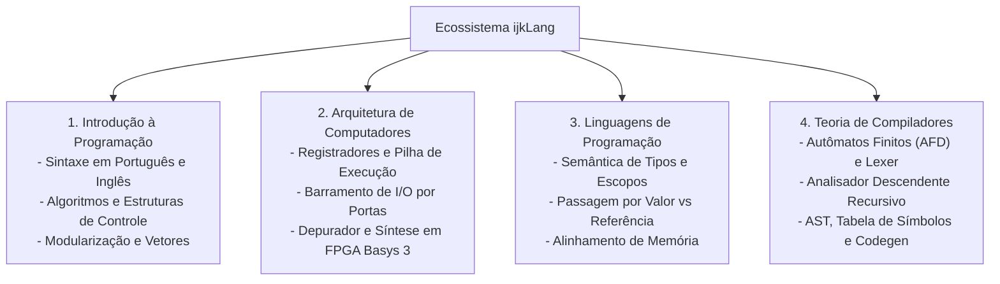

# Apêndice C: Guia Didático para Aplicação no Ensino

Este apêndice oferece um roteiro pedagógico para docentes, coordenadores de curso e estudantes, demonstrando como o ecossistema **ijkLang (`ijkL`)** pode ser adotado de maneira integrada nas quatro disciplinas basilares da formação em Ciência da Computação, Engenharia de Computação e Cursos Técnicos em Informática.

---

## 1. Disciplina: Introdução à Programação de Computadores (Algoritmos)

### 1.1 Objetivos Pedagógicos
- Desenvolver o raciocínio algorítmico sem a sobrecarga inicial da barreira idiomática.
- Facilitar a transição progressiva para a sintaxe padrão internacional em inglês utilizando a mesma ferramenta.
- Praticar estruturas de decisão, laços de repetição, vetores e sub-rotinas com tipagem estática rigorosa.

### 1.2 Roteiro de Laboratórios Sugeridos

#### Prática 1: Estruturas Condicionais e Algoritmos de Decisão
- **Tema**: Cálculo de médias escolares e classificação de categorias.
- **Abordagem Didática**: O aluno implementa o algoritmo utilizando palavras-chave em português (`se`, `senao`) com blocos `{` e `}` e compila com `ijkl`. Em seguida, comuta a chave do arquivo de configuração para inglês (`en-US`) e traduz seu próprio código para `if`, `else`, percebendo que a semântica operacional permanece inalterada.

#### Prática 2: Laços de Repetição e Acumuladores
- **Tema**: Séries matemáticas (Fibonacci, fatorial, somatórios).
- **Abordagem Didática**: Comparação entre o laço com variável de controle explícita (`para (inteiro i = 1 ate N passo 1) { ... }`) e o laço condicional (`enquanto (condicao) { ... }`). Exploração dos índices clássicos *i, j, k* para iterações aninhadas (como geração de tabelas e matrizes).

#### Prática 3: Modularização e Sub-rotinas
- **Tema**: Procedimentos e funções com passagem de parâmetros por valor e por referência (`ref`).
- **Abordagem Didática**: Exercício prático de troca de valores (*swap* de variáveis) para fixar a diferença entre cópia local e alteração da variável de origem na memória.

---

## 2. Disciplina: Arquitetura e Organização de Computadores

### 2.1 Objetivos Pedagógicos
- Desmistificar o funcionamento interno dos processadores, superando a visão da CPU como uma entidade impenetrável.
- Analisar a execução passo a passo de instruções de máquina em registradores e pilha de execução.
- Compreender o conceito de barramento de entrada e saída por portas e a integração com hardware real em FPGA.

### 2.2 Roteiro de Laboratórios Sugeridos

#### Prática 1: Rastreamento de Registradores e Ciclo de Instrução
- **Tema**: Execução do Código Intermediário (`*.ci`) na máquina virtual com a opção `--debug`.
- **Abordagem Didática**: O estudante inspeciona os registradores `r0` a `r4`, o ponteiro de instrução `ci` e observa como operações aritméticas complexas de alto nível se decompõem em instruções atômicas (`load`, `add`, `store`).

#### Prática 2: A Pilha de Chamadas e Recursão
- **Tema**: Funções recursivas e quadros de ativação.
- **Abordagem Didática**: O estudante programa uma função recursiva (ex.: fatorial ou busca binária) e inspeciona o crescimento da pilha através das instruções `alloc_frame` e `free_frame`. Demonstra-se concretamente como o registrador `sp` (Stack Pointer) avança e como o registrador `ra` armazena o endereço de retorno, explicando na prática a origem de falhas por estouro de pilha (*stack overflow*).

#### Prática 3: Barramento de I/O e Periféricos Didáticos
- **Tema**: Comunicação através de portas de entrada e saída (`in` e `out`).
- **Abordagem Didática**: Utilização da API em C (`ijkl_device_api.h`) para controlar um semáforo de trânsito ou mostrador de 7 segmentos simulado, compreendendo o conceito de portas de I/O isoladas.

#### Prática 4: Síntese de Hardware na Placa FPGA Digilent Basys 3
- **Tema**: Da compilação ao circuito lógico em silício.
- **Abordagem Didática**: Conversão do código intermediário pelo montador `ijkl-asm` para arquivos `.mem`, síntese da CPU em VHDL no software Xilinx Vivado e gravação na FPGA Basys 3. O aluno aciona chaves físicas na placa e visualiza o resultado das instruções nos LEDs e displays de 7 segmentos.

---

## 3. Disciplina: Linguagens de Programação

### 3.1 Objetivos Pedagógicos
- Analisar os mecanismos formais de amarração de tipos (*type binding*), escopo estático e tempo de vida de variáveis.
- Estudar a organização física de registros na memória e o fenômeno do alinhamento de bytes.
- Contrastar modelos de passagem de parâmetros e gerenciamento de memória.

### 3.2 Roteiro de Laboratórios Sugeridos

#### Prática 1: Análise de Escopos e Visibilidade
- **Tema**: Escopo global, escopo de sub-rotina e mascaramento (*shadowing*) de variáveis em blocos aninhados.
- **Abordagem Didática**: Utilização da opção `--symtab` do compilador para inspecionar a árvore de escopos gerada, observando como cada identificador é resolvido hierarquicamente.

#### Prática 2: Alinhamento de Memória e Estruturas de Dados
- **Tema**: Impacto da cláusula `alinhar(N)` e cálculo de deslocamentos (*offsets*) em tipos `registro`.
- **Abordagem Didática**: Comparação do tamanho ocupado por registros com campos ordenados de forma alternada versus agrupada, discutindo preenchimento (*padding*) de bytes e desempenho de barramentos de 32 e 64 bits.

---

## 4. Disciplina: Compiladores e Teoria da Computação

### 4.1 Objetivos Pedagógicos
- Compreender a engenharia prática de um compilador clássico sem depender de ferramentas geradoras opacas.
- Praticar a implementação de autômatos finitos determinísticos (léxico) e análise sintática preditiva por descida recursiva.
- Implementar transformações de árvores sintáticas (AST) em representações lineares de três endereços.

### 4.2 Roteiro de Laboratórios Sugeridos

#### Prática 1: Do Autômato ao Reconhecedor Léxico
- **Tema**: Autômatos Finitos Determinísticos (AFD) e decodificação UTF-8.
- **Abordagem Didática**: Análise do arquivo `src/compiler/lexer.c` e da matriz de transição de estados. Proposta de exercício: extensão do autômato para reconhecimento de números em ponto flutuante em base octal ou binária.

#### Prática 2: Gramáticas Livres de Contexto e Analisador Sintático
- **Tema**: Análise sintática descendente recursiva com *lookahead* de um token.
- **Abordagem Didática**: Estudo da correspondência entre as regras EBNF do [Apêndice B](apendice_b_gramatica_sintatica_ebnf.md) e as funções implementadas em `src/compiler/parser.c`. Exercício: inclusão de uma nova estrutura de controle (ex.: laço `faca ... enquanto`).

#### Prática 3: Construção da AST e Geração de Código Intermediário
- **Tema**: Percorrimento de árvores sintáticas tipadas e emissão linear.
- **Abordagem Didática**: Estudo do módulo `src/compiler/codegen.c`, examinando como nós de expressões aritméticas são traduzidos em sequências de instruções com registradores temporários da máquina virtual.
